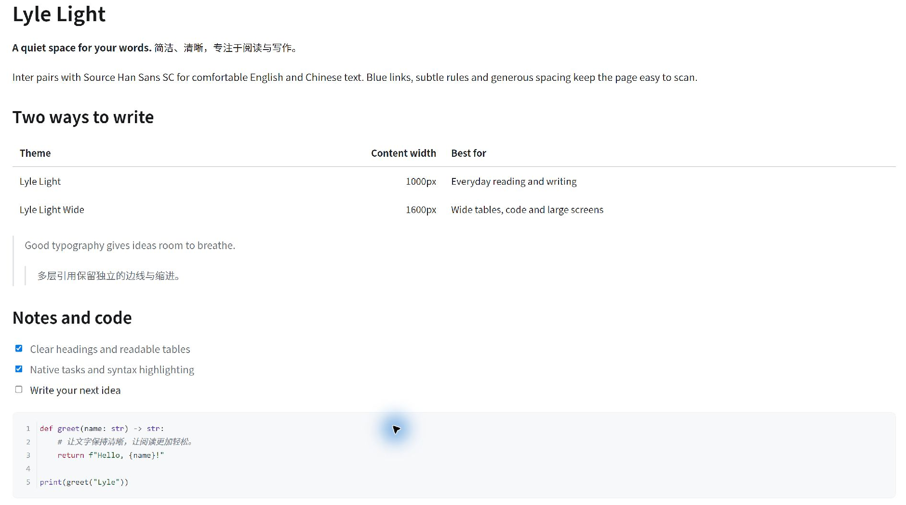

# Lyle Light

A clean light theme for Typora, with comfortable English/Chinese typography, subtle blue-gray accents, and two reading widths.

*Actual Typora preview of the Wide variant on Windows. Fonts and display scaling can change the appearance.*

## Variants

| Theme | File | Maximum content width |
| --- | --- | ---: |
| Lyle Light | `lyle-light.css` | 1000px |
| Lyle Light Wide | `lyle-light-wide.css` | 1600px |

Both files are standalone. They share the same styling and adapt to smaller windows; the wide version gives tables and code more room.

## Installation

1. Download the [latest release](https://github.com/Le0v1n/lyle-light/releases/latest) and extract the ZIP.
2. In Typora, open **Preferences → Appearance → Open Theme Folder**.
3. Copy either or both CSS files directly into that folder.
4. Restart Typora and select **Lyle Light** or **Lyle Light Wide** from the Themes menu.

No plugins, build steps, scripts or remote font downloads are required. To uninstall, switch to another theme and remove the corresponding CSS file.

## Typography

- Screen body: **17px**, normal weight, **1.75** line height.
- Code blocks: **14px**.
- Latin text prefers **Inter**; Chinese text prefers **Source Han Sans SC**.
- Code prefers SF Mono when available and otherwise uses system monospace fallbacks such as Consolas on Windows.
- Fonts are **not bundled**. Without optional fonts, system fallbacks are used.

Optional fonts: [Inter](https://rsms.me/inter/) and [Source Han Sans](https://github.com/adobe-fonts/source-han-sans/releases). For Simplified Chinese, choose the SC desktop fonts. Install them using your operating system and restart Typora.

CSS variables at the start of each file control fonts, size, width, spacing, colors and heading sizes. For example, `--cx-size` controls body size, `--cx-width` controls reading width, and `--cx-table-space` controls table spacing. When customizing both variants, apply shared changes to both files.

## Features

- Native interactive task lists and nested blockquotes.
- Compact table spacing, subtle row rules and a darker header separator.
- Light code blocks with syntax highlighting and distinct diff colors.
- Typora's native math rendering and blue-gray Mermaid styling.
- Keyboard keys, highlights, footnotes, images and HTML details styling.
- A4 print rules with separate body/code sizes and wrapping for long code.

Markdown parsing remains Typora's responsibility. Enable inline math, superscript/subscript, highlight and diagrams in Markdown preferences as needed. For export, use `
` when the details content must appear in the PDF.

## Compatibility and limitations

Developed and tested with **Typora 1.9.5 on Windows**. macOS and Linux have not been tested. The current Wide demo was visually checked in Typora; precise narrow-window regression coverage remains incomplete.

Mermaid layout depends on Typora's bundled Mermaid version. Theme colors may override custom node fill/stroke colors. Large diagrams and tables may still require manual PDF page-break adjustments. The current release has not received a full PDF regression pass. Code inside raw HTML details is readable but may not receive fenced-code syntax highlighting.

Open [demo.md](demo.md) in Typora to try the theme. Report reproducible issues through [GitHub Issues](https://github.com/Le0v1n/lyle-light/issues), including your Typora version and operating system.

## 中文说明

Lyle Light 是一套简洁的浅色 Typora 主题，采用 Inter 与思源黑体，正文 17px、代码块 14px，保留任务清单、多层引用、代码高亮和公式等原生能力。

- **标准版**：最大宽度 1000px，适合日常阅读。
- **宽屏版**：最大宽度 1600px，适合宽表格、代码和大屏。
- 将 CSS 放入「偏好设置 → 外观 → 打开主题文件夹」，重启后在「主题」菜单选择即可。
- 字体需自行安装，主题不包含字体文件；未安装时会使用系统回退字体。

## License

MIT © 2026 [Le0v1n](https://github.com/Le0v1n). See [LICENSE](LICENSE). Optional fonts have their own licenses.
